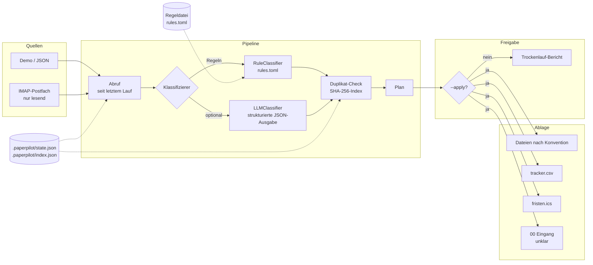

# PaperPilot

**Mail-Triage und Dokumentenablage nach Regeln, mit Fristen-Erkennung, Duplikat-Check, messbarer Trefferquote und menschlicher Freigabe.**

*English summary: a small, dependency-free Python CLI that classifies incoming mail by configurable rules (or optionally an LLM), files documents using a strict naming convention, extracts deadlines into an `.ics` calendar file, keeps an application tracker, and measures classifier accuracy on a labelled test set. Runs instantly in demo mode on anonymous sample data.*

[](https://github.com/trais92/paperpilot/actions/workflows/ci.yml)


Dieses Repo ist die Code-Fassung eines Systems, das ich zuerst mit einem KI-Koordinator und mehreren Agenten über Google-Workspace-Connectoren aufgebaut habe (Mail, Drive, Sheets, Docs, Kalender). Hier steckt derselbe Kern als nachvollziehbarer, testbarer Code: **Regeln statt Bauchgefühl, Trockenlauf vor Ausführung, Messen statt Schätzen.**

---

## In 60 Sekunden ausprobieren

```bash
git clone https://github.com/trais92/paperpilot.git
cd paperpilot
pip install .        # Paketname: paperpilot-ops, Befehl: paperpilot
paperpilot demo
```

Keine Zugangsdaten nötig. Die Demo sortiert 15 anonyme Beispielmails in einen Ordner `demo-ablage/`:

```text
Lauf 2026-11-26 12:05 · 15 Mails · 11 ablegen · 1 zur Prüfung · 2 Werbung · 1 Duplikate

MELDEN (Handlung nötig):
  ! bewerbung/einladung            Kranich-Logistik: Einladung zum Interview – Projektmanager Digitalisierung -> 28.11.2026
  ! bewerbung/absage               Bergwerk-Analytics: Ihre Bewerbung bei Bergwerk Analytics
  ! bewerbung/rueckfrage           Seewind-Energie: Rückfrage zu Ihrer Bewerbung als Projektkoordinator -> 05.12.2026
  ! bewerbung/angebot              Kranich-Logistik: Ihr Vertragsangebot als Projektmanager -> 10.12.2026

ABLAGE:
  + Bewerbungen/Kranich-Logistik/2026-11-18_Kranich-Logistik_Einladung-Interview-Projektmanager-Digitalisierung.md
  + 06 Rechnungen & Belege/2026/2026-11-21_Stadtwerke-Musterstadt_Rechnung-2026-11.pdf
  + 04 Verträge/2026-11-23_Gaswerk-Sued_Vertragsbestaetigung.pdf
  ...

ZUR PRÜFUNG (unklar, liegt im Eingang):
  ? Fotos vom Wochenende  [bester Score 0 < 2]

FRISTEN & TERMINE:
  • 28.11.2026       Einladung zum Interview – Projektmanager Digitalisierung
  • 03.12.2026 11:00 Einladung zum Interview – Projektmanager Digitalisierung
  • 07.12.2026       Bestätigung Ihres Tarifwechsels
  ...
```

Danach liegen im Ordner:

| Ergebnis | Datei |
|---|---|
| Abgelegte Mails und Anhänge nach Konvention `JJJJ-MM-TT_Absender_Thema.ext` | `demo-ablage/<Bereich>/…` |
| Bewerbungs-Tracker, eine Zeile pro Firma, Spalte `neu_aus_mail` als Schnittstelle | `demo-ablage/Bewerbungen/tracker.csv` |
| Fristenliste und **Kalenderdatei** zum Import in Google/Outlook/Apple | `demo-ablage/Fristen/fristen.csv`, `fristen.ics` |
| Unklare Mails für die menschliche Prüfung | `demo-ablage/00 Eingang/` |

Ein zweites `paperpilot demo` meldet `0 Mails`: Die Läufe sind idempotent.

---

## Architektur



| Modul | Aufgabe |
|---|---|
| `sources.py` | Mail-Quellen: JSON für Demo und Tests, IMAP strikt lesend (`readonly`, `BODY.PEEK`) |
| `classify.py` | Regelbasierter Klassifizierer mit erklärbarem Score; optional LLM über die Claude API mit JSON-Schema |
| `config.py` + `default_rules.toml` | Alle Entscheidungen als Konfiguration: Kategorien, Stichwörter, Zielordner, Meldepflicht |
| `naming.py` | Namenskonvention, Umlaute, Stoppwörter, Firmenname aus Absender-Domain |
| `deadlines.py` | Fristen und Termine erkennen (inkl. Uhrzeit, Jahreswechsel), Export als iCalendar |
| `store.py` | Ablage ohne Überschreiben, Duplikat-Index, Lauf-Status, Tracker, Fristenliste |
| `pipeline.py` | Planen und Ausführen getrennt, Bericht nach dem Prinzip „Signal statt Rauschen" |
| `evaluate.py` | Precision, Recall, F1 pro Label, Genauigkeit, Übergabequote an den Menschen |

### Designentscheidungen

- **Human-in-the-loop:** Standard ist der Trockenlauf. Erst `--apply` schreibt. Was der Klassifizierer nicht sicher zuordnen kann, landet als `unklar` im Eingang statt irgendwo falsch.
- **Least Privilege:** Das Postfach wird nur gelesen, Mails werden nicht als gelesen markiert, nichts wird gelöscht oder überschrieben.
- **Konfiguration statt Code:** Neue Kategorie oder neues Stichwort heißt `rules.toml` ändern, nicht Python.
- **Idempotenz:** Jeder Lauf verarbeitet nur Mails seit dem letzten Lauf, und ein Inhalts-Hash verhindert doppelte Ablagen.
- **Messbarkeit:** Jede Regeländerung lässt sich mit `paperpilot eval` gegen ein Testset prüfen. Die CI bricht ab, wenn die Genauigkeit unter 85 % fällt.
- **Keine Abhängigkeiten:** Der Kern nutzt nur die Python-Standardbibliothek. Das LLM ist ein optionales Extra.

---

## Evaluation

```bash
paperpilot eval
```

Ergebnis des regelbasierten Klassifizierers auf dem mitgelieferten Testset (52 anonyme, gelabelte Mails, 13 Klassen):

| Kennzahl | Wert |
|---|---|
| Genauigkeit (Label) | **90,4 %** |
| Genauigkeit (Gruppe: Bewerbung / Privat / Werbung) | **94,2 %** |
| Macro-F1 | 0,905 |
| An den Menschen übergeben (`unklar`) | 11,5 % |

Fehleranalyse aus dem Lauf: Die Regeln verpassen vor allem Formulierungen ohne typische Signalwörter, zum Beispiel eine Absage ohne „leider" („Die Stelle wurde inzwischen besetzt") oder eine Rückfrage, deren Formulierung keines der Bewerbungs-Stichwörter trifft. Wichtig: Diese Fehler landen überwiegend als `unklar` beim Menschen und nicht im falschen Ordner. Werbung und Job-Alerts wurden zu 100 % erkannt.

> **Einordnung:** Testset und Regeln stammen vom selben Autor, die Zahlen sind daher eher optimistisch. Die Regeln wurden bewusst nicht auf die Fehlerfälle nachoptimiert, damit das Testset aussagekräftig bleibt. Der nächste Schritt ist ein größeres Testset aus echten (anonymisierten) Mails und der direkte Vergleich mit dem LLM-Klassifizierer.

---

## Mit echtem Postfach nutzen

```bash
paperpilot init                                   # legt rules.toml zum Anpassen an
paperpilot run --source imap --rules rules.toml --target "G:/Meine Ablage/Persönlich"   # Trockenlauf
paperpilot run --source imap --rules rules.toml --target "G:/Meine Ablage/Persönlich" --apply
```

- Für Gmail: IMAP aktivieren und ein **App-Passwort** anlegen. Benutzer und Passwort kommen aus `PAPERPILOT_IMAP_USER` / `PAPERPILOT_IMAP_PASSWORD` oder werden abgefragt und **nie gespeichert**.
- Als `--target` eignet sich ein per Google Drive for Desktop synchronisierter Ordner. Dann landet die Ablage automatisch im Drive.
- `fristen.ics` lässt sich in jeden Kalender importieren.

### Optional: LLM-Klassifizierer

```bash
pip install ".[llm]"
export ANTHROPIC_API_KEY=...
paperpilot eval --classifier llm      # Trefferquote im Vergleich zu den Regeln messen
```

Der LLM-Klassifizierer nutzt strukturierte Ausgabe (JSON-Schema mit festen Labels). Bei Fehlern, Ablehnung oder ungültiger Antwort fällt er auf `unklar` zurück, also auf menschliche Prüfung. Das Modell lässt sich per `PAPERPILOT_MODEL` setzen.

### Zeitgesteuert ausführen

Linux/macOS (`crontab -e`), täglich um 9 und 21 Uhr:

```cron
0 9,21 * * * cd ~/paperpilot && paperpilot run --source imap --rules rules.toml --apply >> paperpilot.log 2>&1
```

Windows (Aufgabenplanung):

```powershell
schtasks /create /tn "paperpilot-mail" /sc daily /st 09:00 /tr "paperpilot run --source imap --rules C:\paperpilot\rules.toml --apply"
```

---

## Entwicklung

```bash
pip install -e ".[dev]"
pytest          # 20 Tests: Klassifizierung, Fristen, Namenskonvention, Pipeline, Idempotenz, CLI
ruff check .
```

## Roadmap

- [ ] Größeres Testset und Vergleich Regeln vs. LLM (Kosten pro Mail, Genauigkeit)
- [ ] Direkte Google-Drive- und Kalender-Anbindung über die APIs statt Sync-Ordner
- [ ] Strukturierte Extraktion aus PDF-Belegen (Betrag, Datum, Vertragsnummer)
- [ ] Lauf-Protokoll als kleines Dashboard
- [ ] Als MCP-Server bereitstellen, damit ein KI-Agent die Pipeline als Werkzeug nutzen kann

## Lizenz

MIT. Alle Beispieldaten sind frei erfunden und nutzen `.example`-Domains.
