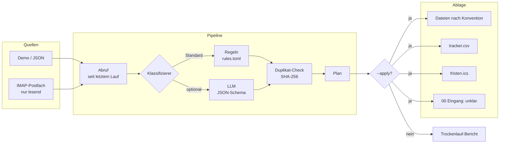

# PaperPilot

**Mail-Triage und Dokumentenablage nach Regeln: Fristen landen im Kalender, Bewerbungen im Tracker, Unklares beim Menschen. Mit messbarer Trefferquote und ohne Abhängigkeiten.**

[](https://github.com/trais92/paperpilot/actions/workflows/ci.yml)


> *English: PaperPilot is a dependency-free Python CLI that classifies incoming mail with configurable rules (or optionally an LLM), files mails and attachments under a strict naming convention, extracts deadlines into an `.ics` calendar file, maintains an application tracker and measures classifier accuracy on a labelled test set. `paperpilot demo` runs instantly on anonymous sample data.*

PaperPilot ist die Code-Fassung eines Systems, das ich zuerst mit einem KI-Koordinator und mehreren Agenten über Google-Workspace-Connectoren betrieben habe. Hier steckt derselbe Kern als nachvollziehbarer, testbarer Code.

**Inhalt:** [Schnellstart](#schnellstart) · [Was passiert](#was-passiert) · [Architektur](#architektur) · [Konfiguration](#konfiguration) · [Evaluation](#evaluation) · [Echtes Postfach](#mit-echtem-postfach) · [Befehle](#befehle) · [Entwicklung](#entwicklung) · [Doku](#dokumentation)

---

## Schnellstart

```bash
git clone https://github.com/trais92/paperpilot.git
cd paperpilot
pip install .          # Paketname: paperpilot-ops, Befehl: paperpilot
paperpilot demo
```

Es werden keine Zugangsdaten und keine zusätzlichen Pakete gebraucht, nur Python 3.11 oder neuer.

## Was passiert

Die Demo verarbeitet 15 frei erfundene Mails (Bewerbungen, Rechnungen, Verträge, Werbung, ein Duplikat, eine private Nachricht) und schreibt das Ergebnis nach `demo-ablage/`. Der Bericht meldet nur, was eine Handlung braucht:

```text
Lauf 2026-11-26 12:56 · 15 Mails · 11 ablegen · 1 zur Prüfung · 2 Werbung · 1 Duplikate

MELDEN (Handlung nötig):
  ! bewerbung/einladung            Kranich-Logistik: Einladung zum Interview – Projektmanager Digitalisierung -> 28.11.2026
  ! bewerbung/absage               Bergwerk-Analytics: Ihre Bewerbung bei Bergwerk Analytics
  ! bewerbung/rueckfrage           Seewind-Energie: Rückfrage zu Ihrer Bewerbung als Projektkoordinator -> 05.12.2026
  ! bewerbung/angebot              Kranich-Logistik: Ihr Vertragsangebot als Projektmanager -> 10.12.2026

ABLAGE:
  + Bewerbungen/Kranich-Logistik/2026-11-18_Kranich-Logistik_Einladung-Interview-Projektmanager-Digitalisierung.md
  + 06 Rechnungen & Belege/2026/2026-11-21_Stadtwerke-Musterstadt_Rechnung-2026-11.pdf
  + 04 Verträge/2026-11-23_Gaswerk-Sued_Vertragsbestaetigung.pdf
  + 09 Wohnen/2026-11-24_Lindenhof-Verwaltung_NK-Abrechnung-2025.pdf
  ... (16 Dateien)

ZUR PRÜFUNG (unklar, liegt im Eingang):
  ? Fotos vom Wochenende  [bester Score 0 < 2]

FRISTEN & TERMINE:
  • 28.11.2026       Einladung zum Interview – Projektmanager Digitalisierung
  • 03.12.2026 11:00 Einladung zum Interview – Projektmanager Digitalisierung
  • 07.12.2026       Bestätigung Ihres Tarifwechsels
  • 15.12.2026       Ihre Rechnung November 2026
  ...

IGNORIERT: 2 Werbe-/Alert-Mails
```

Danach sieht der Ordner so aus:

```text
demo-ablage/
├── 00 Eingang/                       unklare Mails zur menschlichen Prüfung
├── 02 Finanzen/ … 09 Wohnen/         Mails + Anhänge, benannt als JJJJ-MM-TT_Absender_Thema.ext
├── Bewerbungen/
│   ├── Kranich-Logistik/             ein Ordner pro Firma
│   └── tracker.csv                   eine Zeile pro Firma, Spalte "neu_aus_mail"
├── Fristen/
│   ├── fristen.csv
│   └── fristen.ics                   Import in Google, Outlook oder Apple Kalender
└── .paperpilot/                      Duplikat-Index und Stand des letzten Laufs
```

Ein zweites `paperpilot demo` meldet `0 Mails`. Jeder Lauf verarbeitet nur, was seit dem letzten Lauf neu ist, und legt nichts doppelt ab.

## Architektur



| Modul | Aufgabe |
|---|---|
| [`sources.py`](src/paperpilot_ops/sources.py) | Mail-Quellen: JSON für Demo und Tests, IMAP strikt lesend |
| [`classify.py`](src/paperpilot_ops/classify.py) | Regel-Klassifizierer mit erklärbarem Score, optional LLM mit strukturierter Ausgabe |
| [`config.py`](src/paperpilot_ops/config.py) + [`default_rules.toml`](src/paperpilot_ops/default_rules.toml) | Alle Entscheidungen als Konfiguration |
| [`naming.py`](src/paperpilot_ops/naming.py) | Namenskonvention, Umlaute, Firmenname aus der Absender-Domain |
| [`deadlines.py`](src/paperpilot_ops/deadlines.py) | Fristen und Termine erkennen, Export als iCalendar |
| [`store.py`](src/paperpilot_ops/store.py) | Ablage ohne Überschreiben, Duplikat-Index, Lauf-Stand, Tracker, Fristenliste |
| [`pipeline.py`](src/paperpilot_ops/pipeline.py) | Planen und Ausführen getrennt, Bericht |
| [`evaluate.py`](src/paperpilot_ops/evaluate.py) | Precision, Recall, F1, Genauigkeit, Übergabequote |

Details, Datenfluss und Designentscheidungen: [docs/architecture.md](docs/architecture.md).

### Designprinzipien

| Prinzip | Umsetzung |
|---|---|
| Human-in-the-loop | Standard ist der Trockenlauf, erst `--apply` schreibt. Unsichere Fälle gehen als `unklar` in den Eingang. |
| Least Privilege | Postfach nur lesend, nichts wird als gelesen markiert, gelöscht oder überschrieben. |
| Konfiguration statt Code | Kategorien, Stichwörter, Ordner und Meldepflicht stehen in `rules.toml`. |
| Idempotenz | Lauf-Stand plus Inhalts-Hash: kein Doppel, auch bei wiederholten Läufen. |
| Messbarkeit | `paperpilot eval` und eine CI-Schwelle von 85 % schützen vor Verschlechterung. |
| Signal statt Rauschen | Gemeldet werden nur Einladung, Rückfrage, Angebot, Absage und Unklares. |

## Konfiguration

`paperpilot init` legt eine `rules.toml` zum Anpassen an. Eine Kategorie sieht so aus:

```toml
[[categories]]
label = "privat/versicherungen"
folder = "05 Versicherungen"
keywords = ["versicherung", "police", "versicherungsschein", "beitragsanpassung"]
```

Bewerbungen sind zweistufig: Erst muss die Gruppe passen (`[groups.bewerbung]`), dann entscheidet der Untertyp (Einladung, Absage, …). So landet eine Rabatt-Mail mit dem Wort „Angebot" nicht als Jobangebot im Tracker. Platzhalter wie `{company}` und `{year}` werden beim Ablegen ersetzt.

Vollständige Referenz mit allen Feldern und dem Scoring: [docs/configuration.md](docs/configuration.md).

## Evaluation

```bash
paperpilot eval
```

Der Regel-Klassifizierer auf dem mitgelieferten Testset (52 anonyme, gelabelte Mails, 13 Klassen):

| Kennzahl | Wert |
|---|---|
| Genauigkeit pro Label | **90,4 %** |
| Genauigkeit pro Gruppe (Bewerbung / Privat / Werbung) | **94,2 %** |
| Macro-F1 | 0,905 |
| An den Menschen übergeben (`unklar`) | 11,5 % |
| Werbung und Job-Alerts erkannt | 100 % |

Von den 5 Fehlern landen 3 als `unklar` beim Menschen. Nur 2 bekommen ein falsches Label, und eines davon liegt trotzdem im richtigen Firmenordner. Typisch sind Formulierungen ohne Signalwörter, etwa eine Absage ohne „leider" („Die Stelle wurde inzwischen besetzt").

> **Einordnung:** Testset und Regeln stammen vom selben Autor, die Zahlen sind deshalb eher optimistisch. Die Regeln wurden bewusst nicht auf die Fehlerfälle nachoptimiert. Methodik und Grenzen: [docs/evaluation.md](docs/evaluation.md).

## Mit echtem Postfach

```bash
paperpilot init
paperpilot run --source imap --rules rules.toml --target "G:/Meine Ablage/Persönlich"           # Trockenlauf
paperpilot run --source imap --rules rules.toml --target "G:/Meine Ablage/Persönlich" --apply   # ausführen
```

- **Gmail:** IMAP aktivieren und ein App-Passwort anlegen. Benutzer und Passwort kommen aus `PAPERPILOT_IMAP_USER` und `PAPERPILOT_IMAP_PASSWORD` oder werden abgefragt. Sie werden **nie gespeichert**. Anderer Server: `PAPERPILOT_IMAP_HOST`.
- **Cloud-Ablage:** Als `--target` eignet sich ein per Google Drive for Desktop (oder OneDrive, Dropbox) synchronisierter Ordner.
- **Kalender:** `Fristen/fristen.ics` in den Kalender importieren.

### Optional: LLM-Klassifizierer

```bash
pip install ".[llm]"
export ANTHROPIC_API_KEY=...
paperpilot eval --classifier llm
paperpilot run  --classifier llm --source imap
```

Er nutzt die Claude API mit strukturierter Ausgabe (JSON-Schema mit festen Labels). Bei Fehler, Ablehnung oder ungültiger Antwort fällt er auf `unklar` zurück. Das Modell lässt sich mit `PAPERPILOT_MODEL` ändern. Bisher ist er nur mit simulierten Antworten getestet.

### Zeitgesteuert

```cron
# Linux/macOS (crontab -e): täglich 9 und 21 Uhr
0 9,21 * * * cd ~/paperpilot && paperpilot run --source imap --rules rules.toml --apply >> paperpilot.log 2>&1
```

```powershell
# Windows (Aufgabenplanung)
schtasks /create /tn "paperpilot-mail" /sc daily /st 09:00 /tr "paperpilot run --source imap --rules C:\paperpilot\rules.toml --apply"
```

## Befehle

| Befehl | Zweck | Wichtige Optionen |
|---|---|---|
| `paperpilot demo` | Komplettlauf auf Beispieldaten | `--out DIR`, `--reset`, `--rules` |
| `paperpilot run` | Postfach einsortieren (Standard: Trockenlauf) | `--source json\|imap`, `--input`, `--target`, `--classifier rules\|llm`, `--since`, `--apply` |
| `paperpilot eval` | Trefferquote messen | `--testset`, `--classifier`, `--min-accuracy` |
| `paperpilot init` | Regeldatei anlegen | `--path` |

## Entwicklung

```bash
pip install -e ".[dev]"
pytest --cov=paperpilot_ops   # 40 Tests, Abdeckung
ruff check . && ruff format --check .
mypy                          # strenge Typprüfung
paperpilot eval --min-accuracy 0.85
```

Die CI ([`.github/workflows/ci.yml`](.github/workflows/ci.yml)) prüft auf Python 3.11 bis 3.13 Lint, Format, Typen (`mypy --strict`), Tests mit mindestens 85 % Abdeckung, den Demo-Lauf und die Mindest-Trefferquote.

## Dokumentation

| Dokument | Inhalt |
|---|---|
| [docs/architecture.md](docs/architecture.md) | Ports und Adapter, Komponenten, Datenfluss, Designentscheidungen |
| [docs/adr/](docs/adr/README.md) | Architekturentscheidungen mit Alternativen und Folgen |
| [docs/configuration.md](docs/configuration.md) | Alle Felder der Regeldatei, Scoring, Beispiele |
| [docs/evaluation.md](docs/evaluation.md) | Testset, Metriken, Fehleranalyse, Grenzen |
| [docs/roadmap.md](docs/roadmap.md) | Zielbild und geplante Schritte |
| [CLAUDE.md](CLAUDE.md) | Übergabe und Arbeitsregeln für die Weiterentwicklung |
| [CHANGELOG.md](CHANGELOG.md) | Versionen |

## Lizenz

MIT. Alle Beispieldaten sind frei erfunden und nutzen `.example`-Domains.
