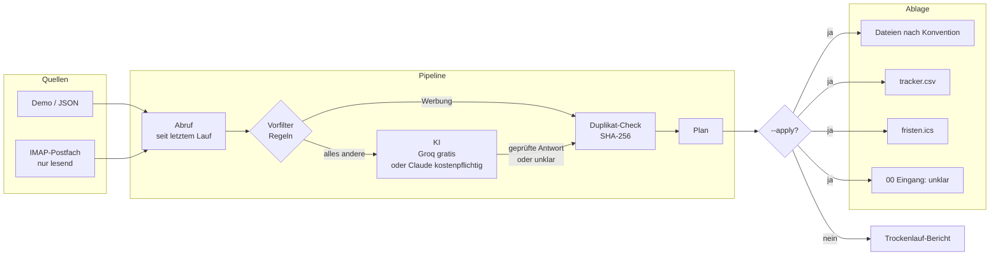

# PaperPilot

**Mail-Triage und Dokumentenablage mit KI: Eine KI ordnet jede Mail ein, Dokumente landen in einer sortierten Ablage, Fristen im Kalender, Unklares beim Menschen. Mit Trockenlauf, messbarer Trefferquote und einem Kern ohne Abhängigkeiten.**

[](https://github.com/trais92/paperpilot/actions/workflows/ci.yml)


> *English: PaperPilot is a Python CLI with a dependency-free core that classifies incoming mail with a hosted language model (free Groq tier by default, optionally Claude, behind one interface; keyword rules act as an advertising pre-filter and offline baseline), files mails and attachments under a strict naming convention, extracts deadlines into an `.ics` calendar file, maintains an application tracker and measures classifier accuracy on a labelled test set. `paperpilot demo` runs instantly on anonymous sample data.*

PaperPilot ist die Code-Fassung eines Systems, das ich zuerst mit einem KI-Koordinator und mehreren Agenten über Google-Workspace-Connectoren betrieben habe. Hier steckt derselbe Kern als nachvollziehbarer, testbarer Code. Drei Grundsätze ziehen sich durch: **Trockenlauf vor Ausführung, im Zweifel der Mensch, Messen statt Schätzen.**

**Inhalt:** [Schnellstart](#schnellstart) · [Was passiert](#was-passiert) · [Architektur](#architektur) · [Konfiguration](#konfiguration) · [Evaluation](#evaluation) · [Echtes Postfach](#mit-echtem-postfach) · [Befehle](#befehle) · [Entwicklung](#entwicklung) · [Doku](#dokumentation)

---

## Schnellstart

```bash
git clone https://github.com/trais92/paperpilot.git
cd paperpilot
pip install .          # Paketname: paperpilot-ops, Befehl: paperpilot
paperpilot demo
```

Es werden keine Zugangsdaten und keine zusätzlichen Pakete gebraucht, nur Python 3.11 oder neuer.

Für das eigene Postfach führt ein Assistent im Browser durch die Einrichtung (Postfach, KI-Schlüssel, Kategorien, Ablageziel) und zeigt danach den ersten Lauf zur Freigabe:

```bash
pip install ".[keyring,pdf]"
paperpilot setup
```

## Was passiert

Die Demo verarbeitet 15 frei erfundene Mails (Bewerbungen, Rechnungen, Verträge, Werbung, ein Duplikat, eine private Nachricht) und schreibt das Ergebnis nach `demo-ablage/`. Der Bericht meldet nur, was eine Handlung braucht:

```text
Lauf 2026-11-26 12:56 · 15 Mails · 11 ablegen · 1 zur Prüfung · 2 Werbung · 1 Duplikate

MELDEN (Handlung nötig):
  ! bewerbung/einladung            Kranich-Logistik: Einladung zum Interview – Projektmanager Digitalisierung -> 28.11.2026
  ! bewerbung/absage               Bergwerk-Analytics: Ihre Bewerbung bei Bergwerk Analytics
  ! bewerbung/rueckfrage           Seewind-Energie: Rückfrage zu Ihrer Bewerbung als Projektkoordinator -> 05.12.2026
  ! bewerbung/angebot              Kranich-Logistik: Ihr Vertragsangebot als Projektmanager -> 10.12.2026

ABLAGE:
  + Bewerbungen/Kranich-Logistik/2026-11-18_Kranich-Logistik_Einladung-Interview-Projektmanager-Digitalisierung.md
  + 06 Rechnungen & Belege/2026/2026-11-21_Stadtwerke-Musterstadt_Rechnung-2026-11.pdf
  + 04 Verträge/2026-11-23_Gaswerk-Sued_Vertragsbestaetigung.pdf
  + 09 Wohnen/2026-11-24_Lindenhof-Verwaltung_NK-Abrechnung-2025.pdf
  ... (16 Dateien)

ZUR PRÜFUNG (unklar, liegt im Eingang):
  ? Fotos vom Wochenende  [bester Score 0 < 2]

FRISTEN & TERMINE:
  • 28.11.2026       Einladung zum Interview – Projektmanager Digitalisierung
  • 03.12.2026 11:00 Einladung zum Interview – Projektmanager Digitalisierung
  • 07.12.2026       Bestätigung Ihres Tarifwechsels
  • 15.12.2026       Ihre Rechnung November 2026
  ...

IGNORIERT: 2 Werbe-/Alert-Mails

ÜBERSICHTEN:
  = 00 Eingang/Übersicht
  = 06 Rechnungen & Belege/Übersicht
  ...
```

Danach sieht der Ordner so aus:

```text
demo-ablage/
├── 00 Eingang/                       unklare Mails zur menschlichen Prüfung
├── 02 Finanzen/ … 09 Wohnen/         Mails + Anhänge (JJJJ-MM-TT_Absender_Thema.ext) und je eine Übersicht.csv
├── 06 Rechnungen & Belege/
│   ├── 2026/                         Dokumente nach Jahr
│   └── Übersicht.csv                 eine Zeile pro Mail: Datum, Absender, Frist, Dateien, Begründung
├── Bewerbungen/
│   ├── Kranich-Logistik/             ein Ordner pro Firma
│   ├── Übersicht.csv
│   └── tracker.csv                   eine Zeile pro Firma, Spalte "neu_aus_mail"
├── Fristen/
│   ├── fristen.csv
│   └── fristen.ics                   Import in Google, Outlook oder Apple Kalender
└── .paperpilot/                      Duplikat-Index und Stand des letzten Laufs
```

Ein zweites `paperpilot demo` meldet `0 Mails`. Jeder Lauf verarbeitet nur, was seit dem letzten Lauf neu ist, und legt nichts doppelt ab.

## Architektur



| Modul | Aufgabe |
|---|---|
| [`sources.py`](src/paperpilot_ops/sources.py) | Mail-Quellen: JSON für Demo und Tests, IMAP strikt lesend |
| [`ai/`](src/paperpilot_ops/ai/) | KI-Schicht: Anbieter als austauschbare Adapter, Reserve-Kette, KI-Klassifizierer mit strenger Prüfung der Antwort |
| [`classify.py`](src/paperpilot_ops/classify.py) | Regel-Klassifizierer mit erklärbarem Score (Vorfilter, Vergleichswert, Demo) |
| [`credentials.py`](src/paperpilot_ops/credentials.py) | Zugangsdaten aus Umgebung oder Schlüsselbund |
| [`composition.py`](src/paperpilot_ops/composition.py) | Verbindet Ports und Adapter an einer Stelle |
| [`config.py`](src/paperpilot_ops/config.py) + [`default_rules.toml`](src/paperpilot_ops/default_rules.toml) | Alle Entscheidungen als Konfiguration |
| [`naming.py`](src/paperpilot_ops/naming.py) | Namenskonvention, Umlaute, Firmenname aus der Absender-Domain |
| [`deadlines.py`](src/paperpilot_ops/deadlines.py) | Fristen und Termine erkennen, Export als iCalendar |
| [`drive/`](src/paperpilot_ops/drive/) | Google Drive als Ablageziel: Anmeldung im Browser (nur `drive.file`), REST-Aufrufe, Übersicht als Google-Tabelle |
| [`store.py`](src/paperpilot_ops/store.py) | Ablage ohne Überschreiben, Duplikat-Index, Lauf-Stand, Tracker, Fristenliste |
| [`pipeline.py`](src/paperpilot_ops/pipeline.py) | Planen und Ausführen getrennt, Bericht |
| [`evaluate.py`](src/paperpilot_ops/evaluate.py) | Precision, Recall, F1, Genauigkeit, Übergabequote |

Details, Datenfluss und Designentscheidungen: [docs/architecture.md](docs/architecture.md).

### Designprinzipien

| Prinzip | Umsetzung |
|---|---|
| Human-in-the-loop | Standard ist der Trockenlauf, erst `--apply` schreibt. Unsichere Fälle gehen als `unklar` in den Eingang. |
| Least Privilege | Postfach nur lesend, nichts wird als gelesen markiert, gelöscht oder überschrieben. |
| Konfiguration statt Code | Kategorien mit Beschreibung, Ordner, KI-Anbieter und Meldepflicht stehen in `rules.toml`. |
| KI mit Leitplanken | Antworten werden gegen die erlaubten Kategorien geprüft; Unsicheres und Ausfälle gehen an den Menschen. |
| Idempotenz | Lauf-Stand plus Inhalts-Hash: kein Doppel, auch bei wiederholten Läufen. |
| Messbarkeit | `paperpilot eval` und eine CI-Schwelle von 85 % schützen vor Verschlechterung. |
| Signal statt Rauschen | Gemeldet werden nur Einladung, Rückfrage, Angebot, Absage und Unklares. |

## Konfiguration

`paperpilot init` legt eine `rules.toml` zum Anpassen an. Eine Kategorie sieht so aus:

```toml
[[categories]]
label = "privat/versicherungen"
folder = "05 Versicherungen"
keywords = ["versicherung", "police", "versicherungsschein", "beitragsanpassung"]
```

Kategorien lassen sich mit `enabled = false` abwählen und mit einer `description` in einem Satz selbst anlegen; mehr braucht die KI nicht. Bewerbungen sind zweistufig: Erst muss die Gruppe passen (`[groups.bewerbung]`), dann entscheidet der Untertyp (Einladung, Absage, …). So landet eine Rabatt-Mail mit dem Wort „Angebot" nicht als Jobangebot im Tracker. Platzhalter wie `{company}` und `{year}` werden beim Ablegen ersetzt.

Vollständige Referenz mit allen Feldern und dem Scoring: [docs/configuration.md](docs/configuration.md).

## Evaluation

```bash
paperpilot eval
```

Der Regel-Klassifizierer (Vorfilter und Vergleichswert) auf dem mitgelieferten Testset (52 anonyme, gelabelte Mails, 13 Klassen). Die KI misst `paperpilot eval --classifier ai`.

| Kennzahl | Wert |
|---|---|
| Genauigkeit pro Label | **90,4 %** |
| Genauigkeit pro Gruppe (Bewerbung / Privat / Werbung) | **94,2 %** |
| Macro-F1 | 0,905 |
| An den Menschen übergeben (`unklar`) | 11,5 % |
| Werbung und Job-Alerts erkannt | 100 % |

Von den 5 Fehlern landen 3 als `unklar` beim Menschen. Nur 2 bekommen ein falsches Label, und eines davon liegt trotzdem im richtigen Firmenordner. Typisch sind Formulierungen ohne Signalwörter, etwa eine Absage ohne „leider" („Die Stelle wurde inzwischen besetzt").

> **Einordnung:** Testset und Regeln stammen vom selben Autor, die Zahlen sind deshalb eher optimistisch. Die Regeln wurden bewusst nicht auf die Fehlerfälle nachoptimiert. Methodik und Grenzen: [docs/evaluation.md](docs/evaluation.md).

Ein zweites, größeres Testset (`paperpilot eval --testset angaben`, 208 Mails mit Beträgen, Fristen und PDF-Anhängen) ist in `dev` und ein nie angesehenes `holdout` geteilt. Dort zeigen die Stichwörter ihre Grenze: 76,4 % auf dev, aber nur 39,1 % auf holdout, weil neue Formulierungen meist als `unklar` beim Menschen landen. Deshalb entscheidet in echten Läufen die KI; ihre Zahlen werden mit einem echten Schlüssel gemessen (siehe [docs/evaluation.md](docs/evaluation.md#testset-mit-angaben-roadmap-5)).

## Mit echtem Postfach

```bash
paperpilot init
paperpilot run --source imap --rules rules.toml --target "G:/Meine Ablage/Persönlich"           # Trockenlauf
paperpilot run --source imap --rules rules.toml --target "G:/Meine Ablage/Persönlich" --apply   # ausführen
paperpilot run --source imap --rules rules.toml --browser   # im Browser prüfen, korrigieren, freigeben
```

Mit `--browser` öffnet sich eine lokale Seite mit dem Plan: pro Mail die erkannte Kategorie, das Ziel und die Begründung. Falsche Kategorien lassen sich dort ändern, erst „Freigeben und ablegen“ schreibt. Die Seite ist nur vom eigenen Rechner aus erreichbar und kommt ohne JavaScript aus ([Sicherheitskonzept](docs/security.md#bericht-im-browser)).

- **Gmail:** IMAP aktivieren und ein App-Passwort anlegen.
- **Zugang einmal speichern:** `pip install ".[keyring]"` und `paperpilot login`. PaperPilot meldet sich zur Probe an und legt Server, Benutzer und App-Passwort im Schlüsselbund des Betriebssystems ab (Windows-Anmeldeinformationsverwaltung, macOS-Schlüsselbund, Secret Service unter Linux), nie in einer Datei. `paperpilot login --status` zeigt, was gespeichert ist, `paperpilot logout` löscht alles wieder.
- **Ohne Schlüsselbund** (Server, CI): `PAPERPILOT_IMAP_HOST`, `PAPERPILOT_IMAP_USER` und `PAPERPILOT_IMAP_PASSWORD` setzen. Umgebungsvariablen haben Vorrang vor dem Schlüsselbund. Was fehlt, wird abgefragt und nicht gespeichert.
- **Google Drive:** `paperpilot login --google` verbindet Drive direkt, ohne Drive-App; danach `--storage drive` oder `[storage] target = "drive"`. PaperPilot sieht dort nur seine eigenen Dateien. Einrichtung: [docs/google-drive.md](docs/google-drive.md). Alternativ eignet sich ein synchronisierter Ordner (Drive, OneDrive, Dropbox) als `--target`.
- **Kalender:** `Fristen/fristen.ics` in den Kalender importieren.

### KI einrichten

```bash
paperpilot login --ai groq        # API-Schlüssel einmal speichern (Schlüsselbund)
paperpilot run --source imap      # Trockenlauf: KI sortiert, nichts wird geschrieben
```

Voreingestellt ist Groq mit seinem kostenlosen Tarif, ohne Kreditkarte. Wer einen eigenen, kostenpflichtigen Claude-Schlüssel hat, kann Claude zusätzlich als Reserve oder statt Groq nutzen (`pip install ".[llm]"`). Die Antwort der KI wird streng geprüft: nur erlaubte Kategorien, Sicherheit unter 0,6 ergibt `unklar`. Fällt jeder Anbieter aus, landet die Mail im Eingang, es wird nicht still auf die Regeln zurückgefallen. Werbung erkennt schon der Vorfilter, sie geht gar nicht an die KI. Ohne KI: `--classifier rules`.

Die KI liest außerdem Betrag, Belegdatum, Rechnungs- oder Kundennummer und Frist aus, auch aus PDF-Anhängen (`pip install ".[pdf]"`). Die Angaben landen in der Übersicht und lassen sich mit `--browser` vor der Freigabe korrigieren; gescannte PDFs ohne Text gehen in den Eingang.

Anbieter, Kosten, Kontingente und was genau gesendet wird: [docs/ai-providers.md](docs/ai-providers.md).

### Zeitgesteuert

```cron
# Linux/macOS (crontab -e): täglich 9 und 21 Uhr
0 9,21 * * * cd ~/paperpilot && paperpilot run --source imap --rules rules.toml --apply >> paperpilot.log 2>&1
```

```powershell
# Windows (Aufgabenplanung)
schtasks /create /tn "paperpilot-mail" /sc daily /st 09:00 /tr "paperpilot run --source imap --rules C:\paperpilot\rules.toml --apply"
```

## Befehle

| Befehl | Zweck | Wichtige Optionen |
|---|---|---|
| `paperpilot setup` | Einrichtung im Browser: Postfach, KI, Kategorien, Ablageziel | `--rules` |
| `paperpilot demo` | Komplettlauf auf Beispieldaten | `--out DIR`, `--reset`, `--rules` |
| `paperpilot run` | Postfach einsortieren (Standard: Trockenlauf) | `--source json\|imap`, `--input`, `--storage local\|drive`, `--target`, `--classifier ai\|rules`, `--since`, `--apply`, `--browser` |
| `paperpilot eval` | Trefferquote messen | `--testset`, `--classifier`, `--min-accuracy` |
| `paperpilot init` | Regeldatei anlegen | `--path` |
| `paperpilot login` | Postfach-Zugang oder KI-Schlüssel im Schlüsselbund speichern | `--ai groq\|claude` (claude kostenpflichtig), `--google`, `--status`, `--no-check` |
| `paperpilot logout` | Gespeicherte Zugangsdaten löschen | |

## Entwicklung

```bash
pip install -e ".[dev]"
pytest --cov=paperpilot_ops   # Tests mit Abdeckung
ruff check . && ruff format --check .
mypy                          # strenge Typprüfung
paperpilot eval --min-accuracy 0.85
```

Die CI ([`.github/workflows/ci.yml`](.github/workflows/ci.yml)) prüft auf Python 3.11 bis 3.13 Lint, Format, Typen (`mypy --strict`), Tests mit mindestens 85 % Abdeckung, den Demo-Lauf und die Mindest-Trefferquote.

## Dokumentation

| Dokument | Inhalt |
|---|---|
| [docs/architecture.md](docs/architecture.md) | Ports und Adapter, Komponenten, Datenfluss, Designentscheidungen |
| [docs/adr/](docs/adr/README.md) | Architekturentscheidungen mit Alternativen und Folgen |
| [docs/ai-providers.md](docs/ai-providers.md) | KI-Anbieter, Kosten, Kontingente, Einrichtung, Quellen |
| [docs/google-drive.md](docs/google-drive.md) | Google Drive verbinden, Rechte, Einrichtung des OAuth-Clients |
| [docs/security.md](docs/security.md) | Sicherheitskonzept: Schutzgüter, Zusagen und die Tests dazu |
| [docs/configuration.md](docs/configuration.md) | Alle Felder der Regeldatei, Scoring, Beispiele |
| [docs/evaluation.md](docs/evaluation.md) | Testset, Metriken, Fehleranalyse, Grenzen |
| [docs/roadmap.md](docs/roadmap.md) | Zielbild und geplante Schritte |
| [CLAUDE.md](CLAUDE.md) | Übergabe und Arbeitsregeln für die Weiterentwicklung |
| [CHANGELOG.md](CHANGELOG.md) | Versionen |

## Lizenz

MIT. Alle Beispieldaten sind frei erfunden und nutzen `.example`-Domains.
