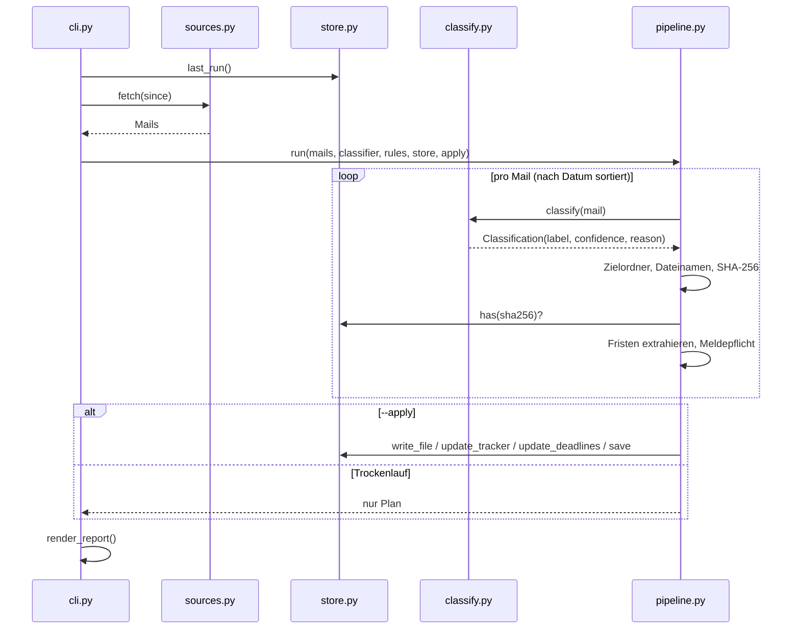

# Architektur

PaperPilot ist eine lineare Pipeline mit einer klaren Trennung zwischen **Planen** (rein, ohne Seiteneffekte) und **Ausführen** (schreibt ins Dateisystem). Diese Trennung ist das Fundament für den Trockenlauf und damit für Human-in-the-loop.

## Überblick

## Komponenten

### `models.py`
Unveränderliche Datenklassen: `Mail`, `Attachment`, `Classification`, `Deadline`, plus die veränderlichen Plan-Objekte `MailPlan` und `PlannedFile`. `Mail` bietet abgeleitete Felder (`sender_domain`, `text`), damit Klassifizierer und Namensgebung nicht selbst parsen müssen.

### `sources.py`
Jede Quelle implementiert `fetch(since) -> Iterator[Mail]` (Protokoll `MailSource`).

- **`JsonSource`** liest eine JSON-Liste oder JSONL. Anhänge als `text` oder `base64`. Wird für Demo, Tests und Evaluation genutzt.
- **`ImapSource`** öffnet das Postfach mit `select(readonly=True)` (entspricht `EXAMINE`) und lädt Nachrichten mit `BODY.PEEK[]`. Dadurch bleibt der Gelesen-Status unverändert. Zeitstempel werden nach UTC normalisiert und als naive `datetime` geführt.

### `classify.py`
Protokoll `Classifier.classify(mail) -> Classification`.

- **`RuleClassifier`** berechnet pro Kategorie einen Score aus Stichwort-Treffern (Betreff ×2, Text ×1) und Absender-Treffern (×3). Kategorien mit `group` zählen nur, wenn die Gruppe **und** eigene Stichwörter treffen. Trifft nur die Gruppe, entsteht `<gruppe>/sonstiges`. Liegt der beste Score unter `min_score`, wird `unklar` zurückgegeben. Bei Gleichstand gewinnt das Label, das gemeldet werden muss (lieber einmal zu viel melden). Details: [configuration.md](configuration.md#scoring).
- **`LLMClassifier`** (optional) ruft die Claude API mit `output_config.format` (JSON-Schema mit `enum` der erlaubten Labels) auf. Jede Störung (Netzwerk, Auth, Ablehnung, kein JSON) führt zu `unklar`, also zur menschlichen Prüfung. Der Client wird injiziert, deshalb lässt er sich ohne Netz testen.

### `naming.py`
- `slug()` entfernt Gender-Klammern wie `(m/w/d)`, ersetzt Umlaute, filtert Stoppwörter und nimmt höchstens 5 Wörter.
- `company_from_mail()` nimmt die Second-Level-Domain (`jobs@karriere.nordlicht-software.example` → `Nordlicht-Software`). Bei Freemail-Domains (`generic_domains`) wird der Anzeigename verwendet.
- `build_filename()` → `JJJJ-MM-TT_Absender_Thema.ext`, Präfixe wie `AW:`/`Re:` werden entfernt.

### `deadlines.py`
Zerlegt den Text in Sätze (Punkte in Datumsangaben bleiben erhalten) und sucht nur in Sätzen mit Signalwörtern (`bis`, `frist`, `spätestens`, `termin`, `fällig`, …) nach Datumsangaben `TT.MM.JJJJ`, `TT.MM.JJ` oder `TT.MM.`. Eine folgende Uhrzeit (`um 11:00 Uhr`) wird übernommen. Datumsangaben ohne Jahr, die vor dem Mail-Datum liegen, rutschen ins Folgejahr. Vergangene Daten werden verworfen. `to_ics()` erzeugt RFC-5545-konforme Termine: ganztägig ohne Uhrzeit, sonst eine Stunde.

### `store.py`
- `LocalStore.write_file()` überschreibt nie: Bei Namenskollision wird `-2`, `-3`, … angehängt.
- `.paperpilot/index.json` ordnet SHA-256 → Pfad zu (Duplikat-Erkennung über Läufe hinweg).
- `.paperpilot/state.json` speichert `last_mail_date`. Der nächste Lauf holt nur neuere Mails.
- `update_tracker()` hält eine Zeile pro Firma. `neu_aus_mail` sammelt Einträge (`NEU Datum · Typ · Betreff · Frist`) als Übergabepunkt für andere Werkzeuge oder Agenten, die selbst keinen Mailzugang haben.
- `update_deadlines()` führt neue Fristen mit der vorhandenen CSV zusammen und erzeugt die `.ics` jedes Mal komplett neu.

### `pipeline.py`
`plan_mail()` entscheidet die Aktion pro Mail:

| Aktion | Wann | Wirkung bei `--apply` |
|---|---|---|
| `ignore` | Kategorie mit `action = "ignore"` (Werbung) | nichts |
| `file` | erkannte Kategorie | Dateien schreiben, Tracker/Fristen aktualisieren |
| `review` | `unklar` | Ablage in `review_folder`, wird gemeldet |
| `duplicate` | alle Dateien schon im Index oder im selben Lauf | nichts |

`run()` sortiert nach Datum, plant alles und führt nur bei `apply=True` aus. `render_report()` erzeugt den Bericht.

### `evaluate.py`
Siehe [evaluation.md](evaluation.md).

### `cli.py`
`argparse` mit den Unterbefehlen `demo`, `run`, `eval`, `init`. Demo- und Testdaten liegen als Paketdaten in `paperpilot_ops/data/` und funktionieren deshalb auch nach `pip install`.

## Designentscheidungen

| Entscheidung | Begründung | Abwägung |
|---|---|---|
| Keine Laufzeit-Abhängigkeiten | Sofort lauffähig, kleine Angriffsfläche, leicht zu prüfen | Kein PDF-Rendering, Mails werden als Markdown abgelegt |
| Regeln vor LLM | Erklärbar, kostenlos, offline, deterministisch testbar | Geringerer Recall bei ungewöhnlichen Formulierungen |
| Planen und Ausführen getrennt | Trockenlauf ohne Sonderlogik, gut testbar | Plan hält Dateiinhalte im Speicher (bei sehr großen Anhängen relevant) |
| `unklar` statt Raten | Ein falsch abgelegtes Dokument ist teurer als eine Rückfrage | Mehr manuelle Prüfung (11,5 % im Testset) |
| Dateisystem statt Drive-API | Funktioniert mit jedem Sync-Client, keine OAuth-Einrichtung | Keine Drive-spezifischen Funktionen (Freigaben, Labels) |
| Inhalts-Hash für Duplikate | Erkennt auch erneut zugestellte Mails mit anderer ID | Minimal veränderte Kopien gelten als neu |
| Naive Zeitstempel (UTC bei IMAP) | Einfacher Vergleich mit dem Lauf-Stand | Uhrzeiten in `.ics` sind „floating“ (lokale Zeit des Kalenders) |

## Herkunft

Die Struktur bildet ein agentisches System nach, das zuvor mit einem KI-Koordinator, parallelen Agenten-Threads und Connectoren zu Mail, Drive, Sheets, Docs und Kalender betrieben wurde. Die Entsprechungen:

| Agentisches System | PaperPilot |
|---|---|
| Geplanter Mail-Agent (9 und 21 Uhr) | `paperpilot run` per cron/Aufgabenplanung |
| Projektgedächtnis mit Regeln | `rules.toml` |
| Freigabe vor Versand/Abschluss | Trockenlauf + `--apply` |
| Tracker-Spalte als Brücke zu einem anderen Projekt | `tracker.csv` → `neu_aus_mail` |
| Fristenliste und Kalendereinträge | `fristen.csv` + `fristen.ics` |
| „Vor dem Ablegen auf Duplikate prüfen“ | SHA-256-Index |
