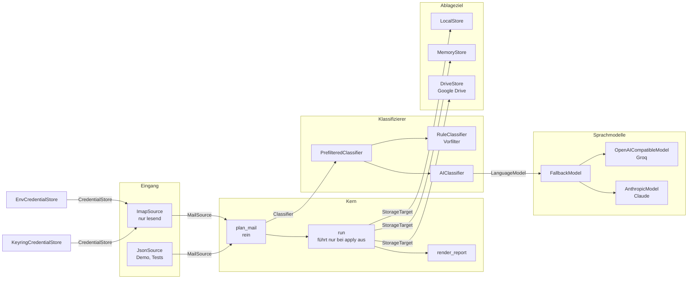
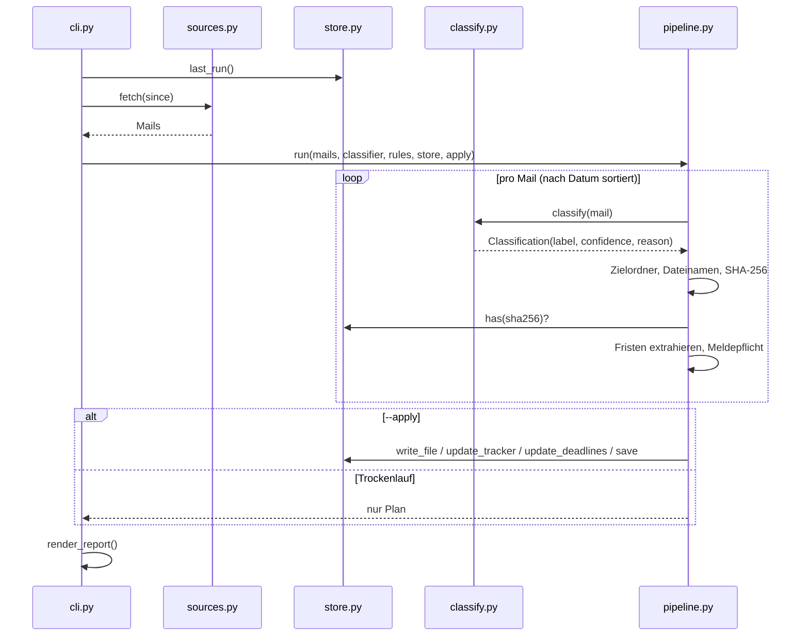

# Architektur

PaperPilot ist eine lineare Pipeline mit einer klaren Trennung zwischen **Planen** (rein, ohne Seiteneffekte) und **Ausführen** (schreibt ins Dateisystem). Diese Trennung ist das Fundament für den Trockenlauf und damit für Human-in-the-loop.

Der Kern kennt nur Schnittstellen (Ports), jede konkrete Technik ist ein austauschbarer Adapter. Warum das so ist und welche Adapter geplant sind, steht in den [Architekturentscheidungen](adr/README.md).

## Ports und Adapter

| Port (`ports.py`) | Vertrag | Adapter | Geplant |
|---|---|---|---|
| `MailSource` | Mails neuer als `since`, Postfach bleibt unverändert | `ImapSource`, `JsonSource` | – |
| `Classifier` | genau ein Label, bei Unsicherheit `unklar` | `PrefilteredClassifier`, `AIClassifier`, `RuleClassifier` | Felder auslesen (Roadmap 4) |
| `LanguageModel` | Antworttext unverändert, jede Störung als `ProviderError`, Schlüssel nie in Meldungen | `OpenAICompatibleModel`, `AnthropicModel`, `FallbackModel` ([ADR 0007](adr/0007-ki-schicht-mit-austauschbaren-modellen.md)) | – |
| `StorageTarget` | nie überschreiben, Duplikat-Index, Übersichten, Lauf-Stand geht nie zurück | `LocalStore`, `MemoryStore`, `DriveStore` ([ADR 0008](adr/0008-google-drive-adapter.md)) | – |
| `CredentialStore` | Zugangsdaten lesen, nie in Dateien oder Logs | `EnvCredentialStore`, `KeyringCredentialStore`, `ChainedCredentialStore` | – |
| `MutableCredentialStore` | zusätzlich speichern und löschen, nur für `login`/`logout` | `KeyringCredentialStore` ([ADR 0004](adr/0004-zugangsdaten-im-schluesselbund.md)) | – |

Jeder Vertrag steht im Docstring des Ports. Für `StorageTarget` prüft [`tests/test_storage_contract.py`](../tests/test_storage_contract.py) jeden Adapter mit denselben Tests; ein neuer Adapter wird dort nur eingetragen.

## Überblick

## Komponenten

### `models.py`
Unveränderliche Datenklassen: `Mail`, `Attachment`, `Classification`, `Deadline`, plus die veränderlichen Plan-Objekte `MailPlan` und `PlannedFile`. `Mail` bietet abgeleitete Felder (`sender_domain`, `text`), damit Klassifizierer und Namensgebung nicht selbst parsen müssen.

### `sources.py`
Jede Quelle implementiert `fetch(since) -> Iterator[Mail]` (Protokoll `MailSource`).

- **`JsonSource`** liest eine JSON-Liste oder JSONL. Anhänge als `text` oder `base64`. Wird für Demo, Tests und Evaluation genutzt.
- **`ImapSource`** öffnet das Postfach mit `select(readonly=True)` (entspricht `EXAMINE`) und lädt Nachrichten mit `BODY.PEEK[]`. Dadurch bleibt der Gelesen-Status unverändert. Zeitstempel werden nach UTC normalisiert und als naive `datetime` geführt.

### `classify.py`
Protokoll `Classifier.classify(mail) -> Classification`.

- **`RuleClassifier`** berechnet pro Kategorie einen Score aus Stichwort-Treffern (Betreff ×2, Text ×1) und Absender-Treffern (×3). Kategorien mit `group` zählen nur, wenn die Gruppe **und** eigene Stichwörter treffen. Trifft nur die Gruppe, entsteht `<gruppe>/sonstiges`. Liegt der beste Score unter `min_score`, wird `unklar` zurückgegeben. Bei Gleichstand gewinnt das Label, das gemeldet werden muss (lieber einmal zu viel melden). Details: [configuration.md](configuration.md#scoring-regel-klassifizierer).
Seit [ADR 0003](adr/0003-ki-fest-eingebaut.md) ist der Regel-Klassifizierer Vorfilter, Vergleichswert und Demo-Klassifizierer.

### `ai/`
Die KI-Schicht ([ADR 0007](adr/0007-ki-schicht-mit-austauschbaren-modellen.md)).

- **`PrefilteredClassifier`** fragt zuerst die Regeln. Ordnen sie die Mail einer Kategorie mit `action = "ignore"` zu (Werbung), ist sie fertig. Alles andere geht an den `AIClassifier`.
- **`AIClassifier`** baut die Anfrage: Systemprompt mit festen Regeln, die erlaubten Kategorien mit ihrer `description`, Absender, Betreff und höchstens 4000 Zeichen Text zwischen festen Begrenzern. Die Antwort wird streng geprüft (JSON-Objekt, Label aus der Liste, Sicherheit 0 bis 1). Abweichungen, Störungen und Antworten unter `min_confidence` ergeben `unklar` mit Grund.
- **`OpenAICompatibleModel`** spricht OpenAI-kompatible Anbieter (heute Groq) über `urllib` an (nur `https`), mit Mindestabstand zwischen Anfragen und einmaligem Warten bei HTTP 429. Der HTTP-Baustein (`ai/http.py`) ist austauschbar, Tests nutzen eine Attrappe.
- **`AnthropicModel`** nutzt das offizielle SDK mit strukturierter Ausgabe; das Paket wird erst beim Gebrauch geladen.
- **`FallbackModel`** fragt den nächsten Anbieter nur bei `ProviderError`, nicht bei inhaltlich falscher Antwort.
- **`providers.py`** kennt Adressen und Standardmodelle und baut die Kette aus `[ai]` und den gespeicherten Schlüsseln.

### `composition.py`
Kompositionswurzel: `make_classifier()` verbindet Ports und Adapter. Die CLI holt sich hier ihre Objekte; der Kern bleibt frei von konkreten Adaptern (Regel 8).

### `naming.py`
- `slug()` entfernt Gender-Klammern wie `(m/w/d)`, ersetzt Umlaute, filtert Stoppwörter und nimmt höchstens 5 Wörter.
- `company_from_mail()` nimmt die Second-Level-Domain (`jobs@karriere.nordlicht-software.example` → `Nordlicht-Software`). Bei Freemail-Domains (`generic_domains`) wird der Anzeigename verwendet.
- `build_filename()` → `JJJJ-MM-TT_Absender_Thema.ext`, Präfixe wie `AW:`/`Re:` werden entfernt.

### `deadlines.py`
Zerlegt den Text in Sätze (Punkte in Datumsangaben bleiben erhalten) und sucht nur in Sätzen mit Signalwörtern (`bis`, `frist`, `spätestens`, `termin`, `fällig`, …) nach Datumsangaben `TT.MM.JJJJ`, `TT.MM.JJ` oder `TT.MM.`. Eine folgende Uhrzeit (`um 11:00 Uhr`) wird übernommen. Datumsangaben ohne Jahr, die vor dem Mail-Datum liegen, rutschen ins Folgejahr. Vergangene Daten werden verworfen. `to_ics()` erzeugt RFC-5545-konforme Termine: ganztägig ohne Uhrzeit, sonst eine Stunde.

### `ports.py`
Die vier Protokolle oben. Keine Logik, nur Verträge.

### `credentials.py`
Alle Adapter kennen nur die fest vereinbarten Schlüssel aus `KEYS` (`imap_host`, `imap_user`, `imap_password`). Ein unbekannter Schlüssel löst `KeyError` aus.

- `EnvCredentialStore` liest Umgebungsvariablen (`PAPERPILOT_IMAP_*`) und speichert nichts.
- `KeyringCredentialStore` nutzt den Schlüsselbund des Betriebssystems über das optionale Paket `keyring` (Dienstname `paperpilot`). Fehlt das Paket oder gibt es auf dem System keinen Schlüsselbund, entsteht ein `CredentialStoreError` mit Hinweis. Fehler des Betriebssystems werden ohne den ursprünglichen Text weitergegeben, weil der einen Wert enthalten könnte.
- `ChainedCredentialStore` fragt mehrere Adapter nacheinander. `default_credential_store()` verkettet Umgebung und Schlüsselbund, sodass Umgebungsvariablen bewusst übersteuern können.

`paperpilot login` fragt die Werte ab, meldet sich zur Probe beim Postfach an und speichert erst danach. `paperpilot logout` löscht alle Einträge. Beim normalen Lauf werden fehlende Werte abgefragt, aber nicht gespeichert. Das Sicherheitskonzept steht in [security.md](security.md).

### `store.py`
- `LocalStore` und `MemoryStore` erfüllen den Port `StorageTarget`.
- `write_file()` überschreibt nie: Bei Namenskollision wird `-2`, `-3`, … angehängt. Rückgabe ist der tatsächlich verwendete relative Pfad.
- `.paperpilot/index.json` ordnet SHA-256 → Pfad zu (Duplikat-Erkennung über Läufe hinweg).
- `.paperpilot/state.json` speichert `last_mail_date`. Der nächste Lauf holt nur neuere Mails.
- `append_rows()`/`read_rows()` führen die Übersichtstabelle pro Zielordner. Der Vertrag (neue Spalten hinten, nichts geht verloren) steckt in `merge_table()` und gilt für jeden Adapter. `LocalStore` schreibt CSV mit Semikolon und BOM für Excel.
- `update_tracker()` und `update_deadlines()` schreiben nur über `read_text`/`write_text` des Ablageziels und funktionieren deshalb mit jedem Adapter.
- `update_tracker()` hält eine Zeile pro Firma. `neu_aus_mail` sammelt Einträge (`NEU Datum · Typ · Betreff · Frist`) als Übergabepunkt für andere Werkzeuge oder Agenten, die selbst keinen Mailzugang haben.
- `update_deadlines()` führt neue Fristen mit der vorhandenen CSV zusammen und erzeugt die `.ics` jedes Mal komplett neu.

### `drive/`
Google Drive als Ablageziel ([ADR 0008](adr/0008-google-drive-adapter.md)), nur Standardbibliothek.

- **`oauth.py`**: Anmeldung mit PKCE und Rückruf auf `127.0.0.1`, Scope `drive.file`. `GoogleSession` tauscht das Refresh-Token aus dem Schlüsselbund bei Bedarf gegen ein Zugriffstoken.
- **`api.py`**: `DriveApi` mit sechs Aufrufen (suchen, Ordner anlegen, hochladen, Inhalt ersetzen, herunterladen, exportieren), erneuert das Token einmal bei HTTP 401. Es gibt keinen Lösch-Aufruf.
- **`store.py`**: `DriveStore` bildet Pfade auf Ordner ab (mit Zwischenspeicher pro Lauf), legt Übersichten als Google-Tabelle an und hält Index und Lauf-Stand in `.paperpilot/`.

`composition.make_store()` wählt anhand von `[storage]` bzw. `--storage` zwischen `LocalStore` und `DriveStore`.

### `pipeline.py`
`plan_mail()` entscheidet die Aktion pro Mail:

| Aktion | Wann | Wirkung bei `--apply` |
|---|---|---|
| `ignore` | Kategorie mit `action = "ignore"` (Werbung) | nichts |
| `file` | erkannte Kategorie | Dateien schreiben, Tracker/Fristen aktualisieren |
| `review` | `unklar` | Ablage in `review_folder`, wird gemeldet |
| `duplicate` | alle Dateien schon im Index oder im selben Lauf | nichts |
| `skip` | Kategorie erkannt, aber mit `enabled = false` abgewählt | nichts, im Bericht unter „nicht gewählt“ |

`run()` sortiert nach Datum, plant alles und führt nur bei `apply=True` aus. Beim Ausführen sammelt es die Zeilen pro Übersichtstabelle (mit den tatsächlich verwendeten Dateinamen) und schreibt jede Tabelle einmal. `render_report()` erzeugt den Bericht.

### `evaluate.py`
Siehe [evaluation.md](evaluation.md).

### `cli.py`
`argparse` mit den Unterbefehlen `demo`, `run`, `eval`, `init`, `login`, `logout`. Demo- und Testdaten liegen als Paketdaten in `paperpilot_ops/data/` und funktionieren deshalb auch nach `pip install`.

## Designentscheidungen

Die wichtigsten Entscheidungen sind als [ADRs](adr/README.md) mit Alternativen begründet. Die Tabelle fasst den aktuellen Stand zusammen.

| Entscheidung | Begründung | Abwägung |
|---|---|---|
| Keine Laufzeit-Abhängigkeiten | Sofort lauffähig, kleine Angriffsfläche, leicht zu prüfen | Kein PDF-Rendering, Mails werden als Markdown abgelegt |
| KI sortiert, Regeln filtern vor ([ADR 0003](adr/0003-ki-fest-eingebaut.md), [0007](adr/0007-ki-schicht-mit-austauschbaren-modellen.md)) | Versteht Formulierungen ohne Stichwort, eigene Kategorien per Beschreibung | Mail-Inhalte gehen an einen Anbieter; Antworten müssen geprüft werden |
| Planen und Ausführen getrennt | Trockenlauf ohne Sonderlogik, gut testbar | Plan hält Dateiinhalte im Speicher (bei sehr großen Anhängen relevant) |
| `unklar` statt Raten | Ein falsch abgelegtes Dokument ist teurer als eine Rückfrage | Mehr manuelle Prüfung (11,5 % im Testset) |
| Lokal oder Google Drive ([ADR 0005](adr/0005-ablage-ordnerstruktur-lokal-oder-drive.md), [0008](adr/0008-google-drive-adapter.md)) | Ablage dort, wo Menschen ihre Dateien ohnehin suchen; Drive ohne Desktop-App | Drive braucht einen registrierten OAuth-Client |
| Ports als `typing.Protocol` ([ADR 0002](adr/0002-ports-und-adapter.md)) | Adapter austauschbar, Kern ohne Netz testbar, `mypy --strict` prüft die Verträge | Eine Indirektion mehr beim Lesen des Codes |
| Inhalts-Hash für Duplikate | Erkennt auch erneut zugestellte Mails mit anderer ID | Minimal veränderte Kopien gelten als neu |
| Naive Zeitstempel (UTC bei IMAP) | Einfacher Vergleich mit dem Lauf-Stand | Uhrzeiten in `.ics` sind „floating“ (lokale Zeit des Kalenders) |

## Herkunft

Die Struktur bildet ein agentisches System nach, das zuvor mit einem KI-Koordinator, parallelen Agenten-Threads und Connectoren zu Mail, Drive, Sheets, Docs und Kalender betrieben wurde. Die Entsprechungen:

| Agentisches System | PaperPilot |
|---|---|
| Geplanter Mail-Agent (9 und 21 Uhr) | `paperpilot run` per cron/Aufgabenplanung |
| Projektgedächtnis mit Regeln | `rules.toml` |
| Freigabe vor Versand/Abschluss | Trockenlauf + `--apply` |
| Tracker-Spalte als Brücke zu einem anderen Projekt | `tracker.csv` → `neu_aus_mail` |
| Fristenliste und Kalendereinträge | `fristen.csv` + `fristen.ics` |
| „Vor dem Ablegen auf Duplikate prüfen“ | SHA-256-Index |
